# Assignment 2

## Task 1: Revisit your data and questions
My dataset grew from 15 to 35 responses (Sept 21 to Oct 20). My corporate contact did send the printed box toppers, but they arrived after the Assignment 1 deadline, and 20 of the 35 responses came in after it. The data is still mostly from Lansing (30 responses). West Loop went from 1 response to 4, which is still too few to compare locations, and one person left the location blank. Satisfaction is almost all 5s (26 of 35), and the sample is self-selected, so it probably leans toward happy and engaged customers. I found a few problems with the data. The order question was free text, so I grouped orders by keyword, and I marked 3 answers ("nothing," "Delivery," and a blank) as unclear. One atmosphere rating was blank and I left it blank instead of guessing. I kept the original export unchanged and saved the cleaned version separately. My questions changed. I am keeping three: (1) does visit frequency relate to which new items people have tried or heard of, since only 7 of 35 have tried any; (2) do orders differ by age range, reworded because almost everyone orders pizza, so it is really about who orders more than pizza; and (3) how do satisfaction and response volume change over time, which is new because responses came in bursts. I dropped the location comparison because West Loop has only 4 responses, and the atmosphere question because it barely varies. My old question about the share who tried the new items is now part of question 1.

## Task 2: Prepare the data

The data goes through one script, `01_clean.py`. It reads the original Google Forms export (`data/original/survey-responses-a2.csv`) and writes the cleaned version to `data/processed/survey_clean.csv`, which is what every chart uses. Running the script from the `assignment-2` folder rebuilds the processed file. No rows were dropped.

The main changes:
- Shortened the long question text into column names, and turned timestamps into dates and hours.
- Filled the blank location as "Unknown." The blank atmosphere rating stays blank.
- Put visit frequency and age range in their natural order so charts sort correctly.
- Split the new-items checkboxes into one true/false column per answer, then made a three-group summary: tried at least one, heard of them but haven't tried, and haven't heard of them. People who checked both "haven't tried" and "haven't heard" are in the last group.
- Sorted the typed-in orders into groups by keyword (pizza only, pizza plus something else, no pizza, unclear), because almost everyone orders pizza and the exact wording adds little.
- Flagged comments that mention price, since several do.

The keyword grouping is my own rule, so a few orders could be grouped wrong.

## Task 3: Explore the data

I made four quick charts to see what the data could support. Each one counts responses.

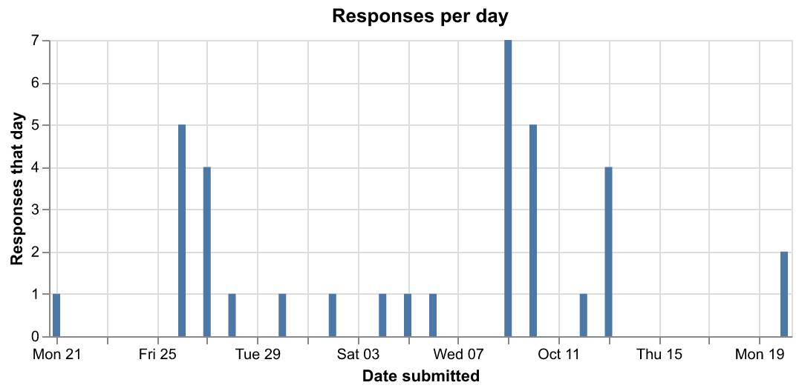

Responses came in bursts, not steadily. Most arrived on Sept 26-27 (9 responses), Oct 9-10 (12), and Oct 13 (4), with none between Oct 14 and Oct 19. The bursts mostly follow when the box toppers were in stock at the stores, so this chart shows how my data was collected, not how customers behave. That matters for any time-based view, because a pattern over time here would mostly reflect the box toppers.

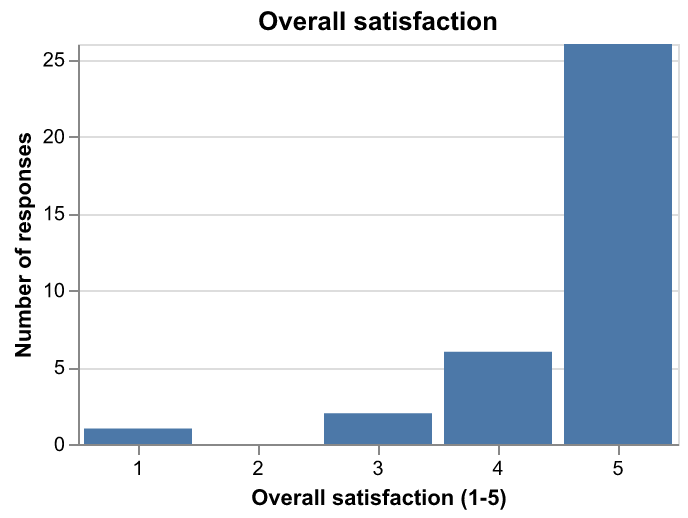

This one was not useful. 26 of 35 gave a 5, and nobody gave a 2. A chart of the distribution is basically one tall bar, so I will not use it as a main direction. The only real low rating is a 3 with a food rating of 1 (a comment about sauce and salt).

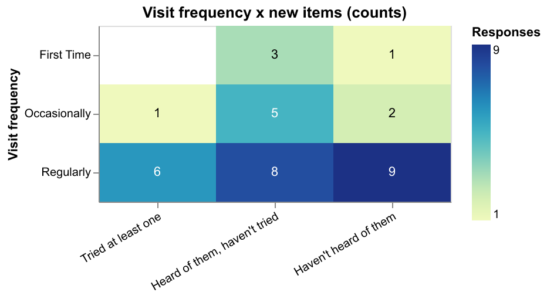

This was the most interesting chart. Only 7 of 35 have tried a new item. Among the 23 regulars, 9 have not heard of the new items at all. That is surprising since regulars see the menu the most. Regulars were 23 of the 35 responses, so the overall numbers mostly describe regulars, and the first-time row has only 4 people, so I can’t read much into it.

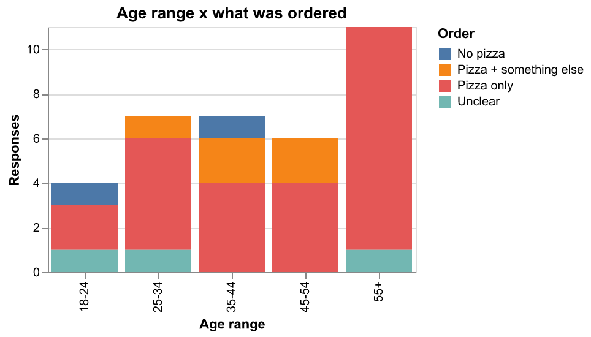

Almost everyone orders pizza. All 10 clear orders in the 55+ group are pizza only, while the 25-54 groups have a few people ordering salad, wings, or extras. The groups are different sizes, so counts can mislead, and any pattern here rests on very few people.

These charts changed my plan. The satisfaction chart showed there is too little variation to be a main chart, and the order chart showed I should compare "pizza only vs. more than pizza" instead of every order type.

## Task 4: Implement visualization alternatives

### Direction 1: Visit frequency by new items

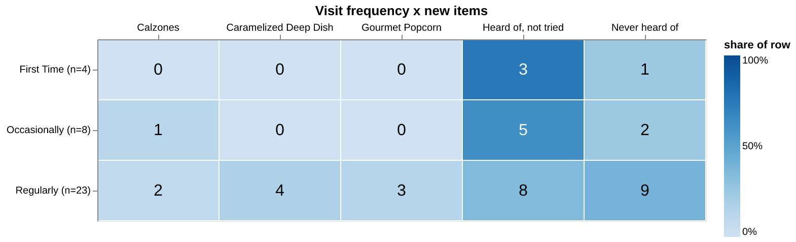

This supports the question of whether visit frequency relates to which new items people have tried or heard of. It uses visit frequency and the new-items answers. The marks are rectangles, and the channels are position (row and column), color lightness (share of that row), and a number (the count). I shaded by share instead of count because the rows are very different sizes. It shows that 3 of 4 first-timers have heard of the items but not tried them, and that regulars have the most people who never heard of them. The problem is that the three item columns overlap, since people could check several, so rows don't add up to 100%, and the small rows only have a few people. I am keeping this one.

### Direction 2: Responses over time

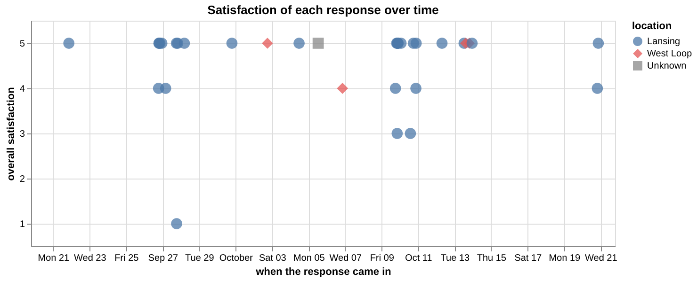

This supports the question of when responses came in and whether low ratings cluster. It uses time, satisfaction, and location. The marks are points, and the channels are horizontal position (time), vertical position (satisfaction), and shape and color (location). It makes the bursts easy to see and shows the three low ratings are spread out. But almost everything is a 5, so the chart is flat, and the time pattern mostly shows when the box toppers were in stock, not how customers behave. I am abandoning it as a main chart, but it may be useful as a small context view.

### Direction 3: What people ordered, by age range

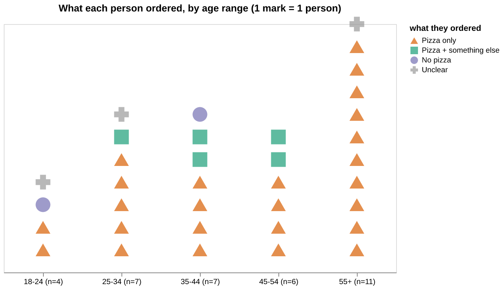

This supports the question of whether orders differ by age. It uses age range and the order group. Each person is one mark, positioned by age group and stacked, with shape and color showing what they ordered. I used one mark per person so group sizes stay visible. It shows that all clear orders in the 55+ group are pizza only, while the 25-54 groups have a few people ordering more. But most marks are the same orange triangle, so there is not much to see, and stack height depends on how many people answered, so groups of different sizes are hard to compare. I would modify it if I keep it.

## Task 5: Interaction and multiple views

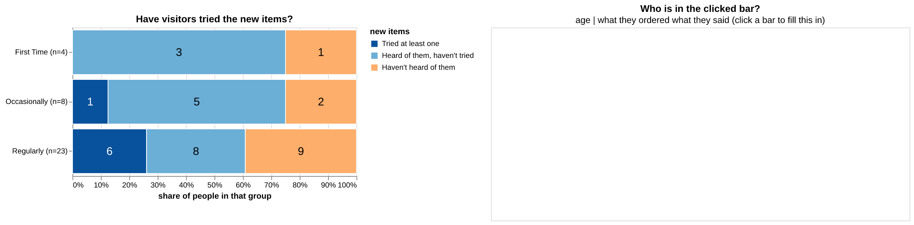
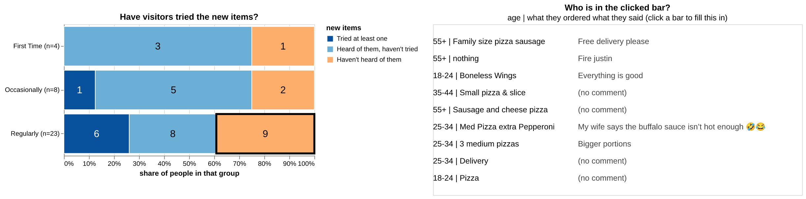

I added one interaction. When you click a part of a bar, a list shows up on the right with the people in that part: their age, what they ordered, and what they said. Hovering over a bar also shows the count and percent. I didn't add filters or dropdowns because there isn't enough data to need them.

## Task 6: Iterate and refine

I picked Direction 1 (visit frequency by new items) because it was the only one that answered a real question. The other two were mostly flat.

### Iteration 1: shaded grid to stacked bars

Before:

After:
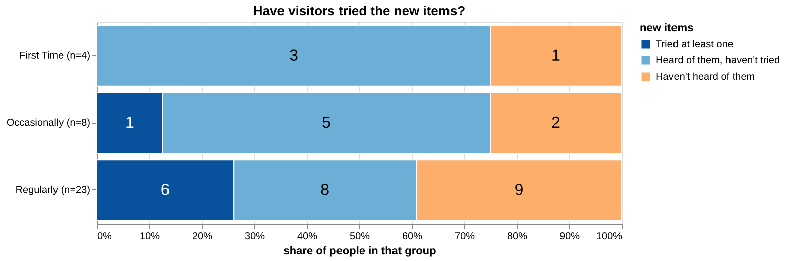

**Problem:** I was visually wary of the shading as something potentially difficult to distinguish among boxes. The colors were based on the share of each row. 

**Change:** I regrouped everyone into three groups: tried at least one, heard of them but haven't tried, and haven't heard of them. Each visit frequency is now a bar from 0 to 100%, split into those groups, with the count written inside. Now you compare bar lengths, which is easier than comparing shades.

**Tradeoff:** I lost which items people tried.

### Iteration 2: add a chart of which items were tried

Before:

After:
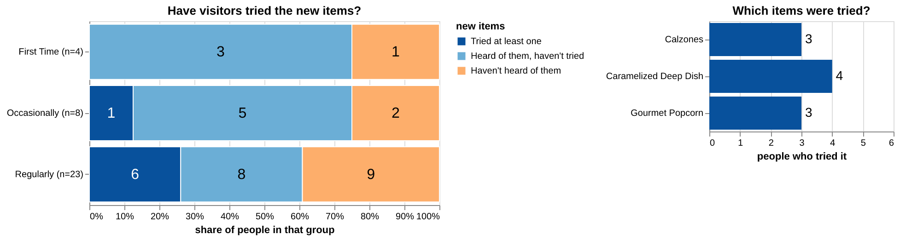

**Problem:** the stacked bars no longer showed which items people tried. That was the main thing I lost in iteration 1.

**Change:** I added a small bar chart next to the stacked bars that counts how many people tried each item: 3 calzones, 4 caramelized deep dish, and 3 gourmet popcorn. Those add up to 10, but only 7 people tried anything, since some people tried more than one item.”

**Tradeoff:** the layout is more crowded, and the item chart is not split by visit frequency, so you can't see which kind of visitor tried which item.

## Task 7: Current design

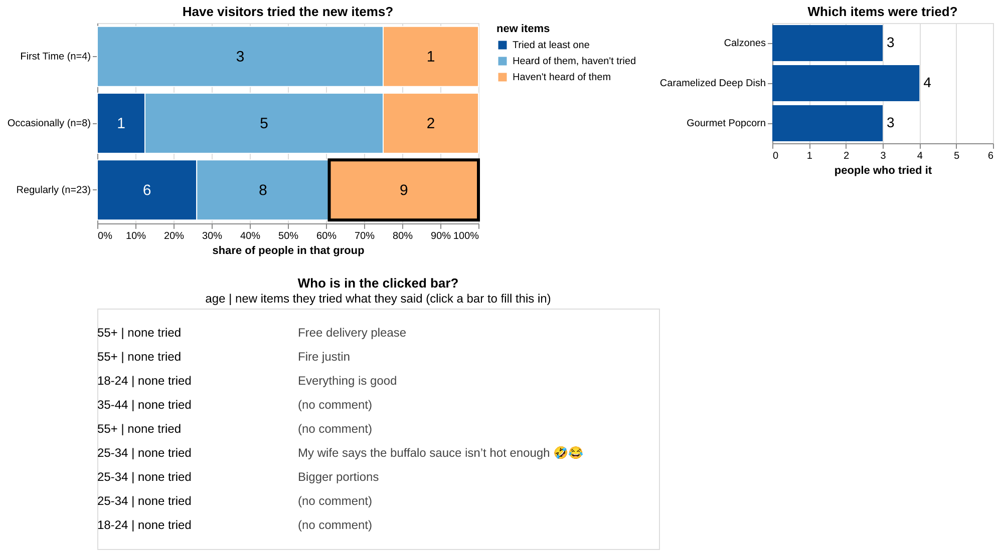

The working version is `visualization.html` (the most recent one).

**What it supports:** it answers whether people who visit more often have tried the new items, and which items got tried. Clicking a bar shows who is in that group and what they said. For example, 9 of the 23 regulars have never heard of the new items.

**Main design decisions:** I used one bar per visit frequency, split into three groups that don't overlap, so you compare bar lengths instead of shades. I added a separate chart for which items were tried, since the bars don't show that. The click list is there because with 35 responses it's worth reading the actual comments.

**How it differs from before:** my assignment 1 sketches included a histogram (sketch 2) and a shaded grid of the survey waves (sketch 3). Neither one is in the current design. The shaded grid idea did carry over into direction 1, which started as a shaded grid, then became stacked bars (iteration 1), then got the item chart (iteration 2), and finally the click list from task 5. The histogram of satisfaction didn't survive, because almost everyone gave a 5. I also dropped the timeline and the age chart because they were flat or not very useful.

**What works:** the bars are easy to read, and the biggest gap (regulars who never heard of the new items) stands out. The list makes the numbers feel like real people.

**What I'm unsure about:** the groups are small. First time is only 4 people, so the percentages for that bar can jump a lot. The item chart doesn't show who tried what. The list is empty until you click, and people might not realize it's clickable. The list also says "none tried" for people who tried nothing, which is a little repetitive.

**What I want to evaluate in Assignment 3:** whether people notice that the bars are clickable, and whether they read the bars correctly (counts inside, percent as length). I also want to test whether the item chart is useful or just clutter, and whether the layout is clear.
